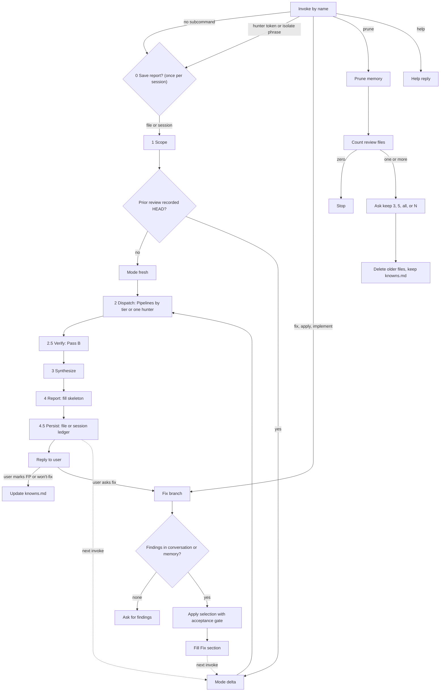

# Code Review Plus

Review a PR or diff for bugs, security, and code quality. Invoke by name, or add a hunter (`/code-review-plus quality`) to run that pass only.

## Commands

| Command                         | When                                                                                 |
| ------------------------------- | ------------------------------------------------------------------------------------ |
| `/code-review-plus`             | Review the current diff, branch, or named files with the hunters the tier requires   |
| `/code-review-plus <hunter>`    | One hunter (`correctness`, `security`, `architecture`, `quality`, `performance`)     |
| `/code-review-plus fix`         | Apply P0, P1, and vuln; then leftover IDs (`fix all` or `fix 2,5`)                   |
| `/code-review-plus fix all`     | Apply every P0–P3 finding (nits included)                                            |
| `/code-review-plus fix 2,3,6`   | Apply those Findings IDs (spaces also work)                                          |
| `/code-review-plus prune`       | Drop old files under `docs/code-review/` (count first, then choose how many to keep) |
| `/code-review-plus help`        | Explain how this skill works                                                         |

The first reserved token (`fix` / `apply` / `implement` / `prune` / `help`) wins. After `fix`, the remainder is `all`, finding IDs, or empty (the default). Isolation is a hunter name, or `code quality` / `page performance` / `only` + hunter. Two hunter names without `only` stay a full review.

## How it works

First, the skill asks once per session whether to save the report under `docs/code-review/` or keep it in this session only. Then the orchestrator scopes the change: intent, size, dispatch tier, stack tags, and the `Pipelines` that will run. It reads the prior memory: the newest session ledger, or `knowns.md` and the newest review file for this branch. Known false positives stay closed unless the cited path changed. A prior isolated review covers only the hunters it listed. If a prior review recorded a HEAD that is still in this branch's history, this pass is delta and hunts the hunks since that commit. Open findings from that review stay in the table, so none drops out unfixed. The hunters that ran re-check their own, the orchestrator re-checks those owned by a hunter the tier skips, and dismissed findings stay closed.

Default pipelines:

- **trivial:** Correctness + Quality (Security if the diff touches a sensitive surface)
- **normal:** Correctness + Security + Quality
- **large/sensitive:** those three plus Architecture

Performance runs only when isolated.

Each hunter gets one perspective and at most one stack shape, picked by priority. Security gets the `llm` shape only; the other hunters get the majority language shape. The Security perspective has no hunt list; it gives the hunter a method and a confidence bar. The other hunt lists are a floor: the hunter covers every listed item, then reports other issues in its scope that have a cost today. A clear issue owned by a hunter that did not run is reported too; an isolated review reports it only at P0/P1 level. The Quality hunter reads `quality.md`, which opens `make-code` when that skill is in the environment; otherwise it hunts the default Floor in `quality.md` and the report says so. Either way it also covers docs sync, dead code, and tests already in the diff (`test-quality.md` when tests are in source).

When the hunters return, the orchestrator checks every candidate against the code (Pass B), assigns severity, and puts every kept finding in the report. It marks each finding as new or prior, writes the memory (a file under `docs/code-review/` or a session ledger at the end of the reply), then replies with the report.

## Flow

## Review memory

These files belong in the reviewed repo, not in this skill folder. The skill does not commit them.

- `docs/code-review/YYYY-MM-DD-HH-MM.md`: findings from that review. `/code-review-plus fix` adds a `## Fix` section on first apply.
- `docs/code-review/knowns.md`: created when you mark a finding as a false positive or won't-fix

When you choose not to save, nothing is written in the repo. The same memory lives in a session ledger at the end of each reply, and later review, fix, and knowns calls in that session update it.

The next review reads those files and runs as delta when a prior HEAD exists. Fix loads findings from this conversation or from that memory, reads `## Fix` for already-closed items, and updates the same file. Bare `fix` applies P0, P1, and vuln, then names leftover IDs. Any `fix` reads `make-code` when that skill is in the environment (make-code picks write or refactor per finding; Clean fix otherwise). Each fix re-reads the callers, contracts, and tests in `regression_risk` and reports any risk left: what can break, where, and how to check it. After a fix, the next `/code-review-plus` is delta: it re-checks closed paths, keeps new P0/P1 there, and keeps any regression at a risk the fix stated.

`/code-review-plus prune` counts timestamped review files first, then asks whether to keep the last 3, the last 5, delete all, or keep a number you type. `knowns.md` stays.

## Files

- [`SKILL.md`](SKILL.md): router (review vs fix vs prune vs help; hunter override on review)
- [`references/phases/`](references/phases/): save, scope, dispatch, verify, synthesize, persist, knowns, fix, prune, help
- [`references/perspectives/`](references/perspectives/): the five hunters (`quality.md` is the Quality entry point and holds the default Floor)
- [`references/shapes/`](references/shapes/): optional stack overlays
- [`references/test-quality.md`](references/test-quality.md): tests already in the diff (Quality)
- [`references/complexity.md`](references/complexity.md): cyclomatic vs cognitive load, YAGNI, CC Floor cap 20 (orchestrator, Pass B)
- [`references/templates/report.md`](references/templates/report.md): report skeleton
